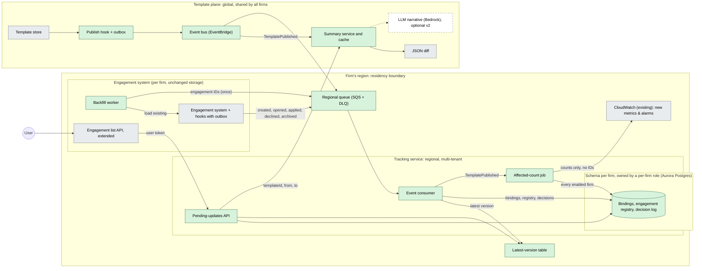
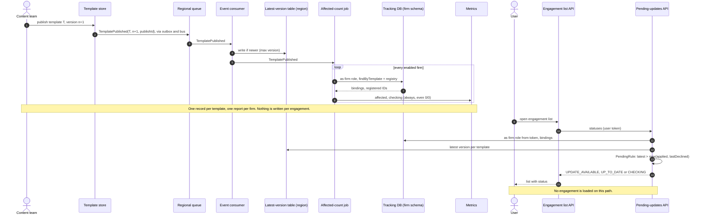

# Diagrams

Companion to [DESIGN.md](DESIGN.md). Green boxes are new; grey boxes are existing systems; the
dashed box is optional.

## 1 Architecture

Only template data (publish events, summaries) crosses into the region from the global plane.
Out of it go only counts to metrics and summary requests carrying template IDs and versions.
Bindings, the registry and decisions stay in the firm's schema, in the firm's region; every
transaction on firm data runs as that firm's role.

## 2 Publish to visible status

A publish writes one record per template and one count per firm; nothing is written per
engagement. When the user opens the list, status is derived from the firm's bindings and the
latest version.
