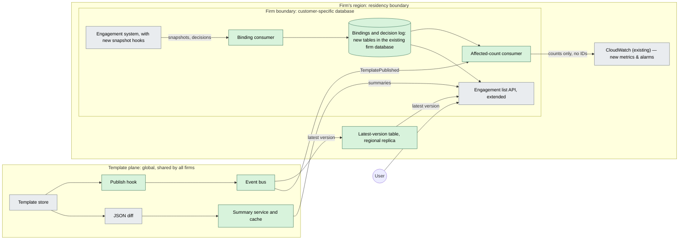
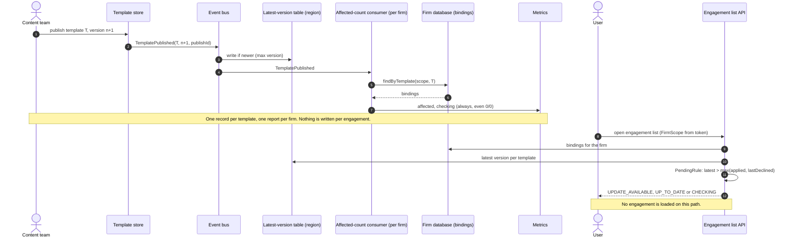

# Diagrams

Companion to [DESIGN.md](DESIGN.md). Green boxes are new; grey boxes are existing systems.

## 1 Architecture

Only template data (latest versions, publish events, summaries) enters the firm boundary, and only
counts leave it. Bindings and decisions stay in the firm's database and region.

## 2 Publish to visible status

A publish writes one record per template and one count per firm; nothing is written per
engagement. When the user opens the list, status is derived from bindings and the latest version.
